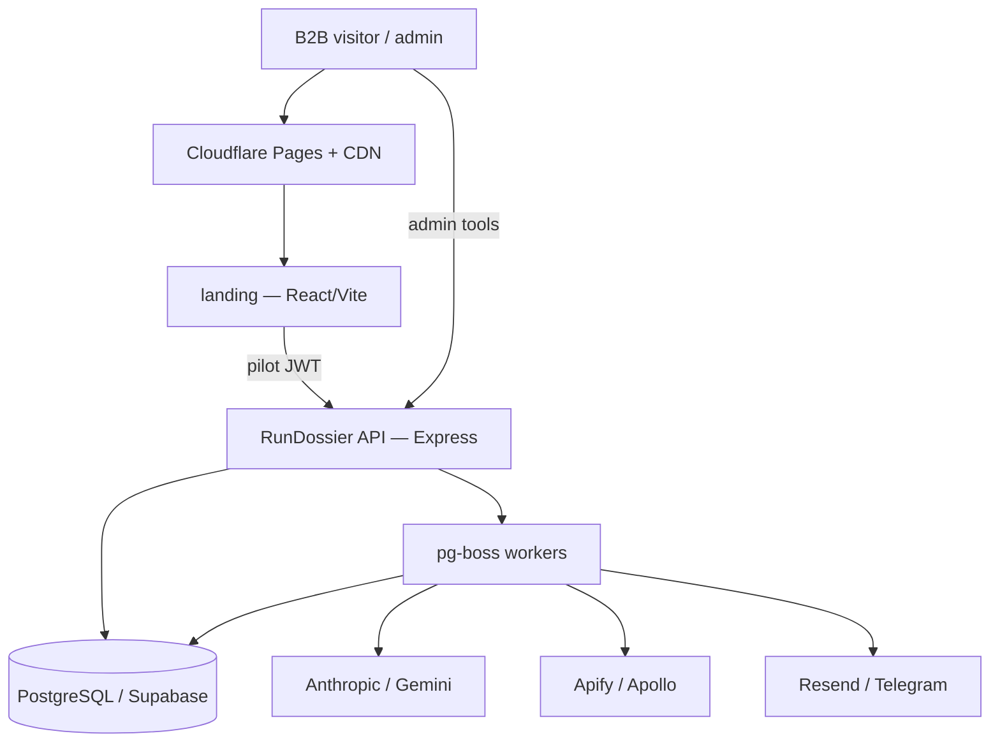

# Architecture

Dossier (Preframe) is a B2B outbound opener service: marketing site + API/worker pipeline.

## System context

## Containers

| Container | Tech | Responsibility |
|-----------|------|----------------|
| `landing/` | React 18, Vite | Marketing, legal pages, pilot form |
| `RunDossier/` | Express 5, TypeScript | REST API, job orchestration |
| PostgreSQL | Supabase | Prospects, jobs, audit, pilot requests |
| pg-boss | in-process | Research → personalize → delivery pipeline |

## Security boundaries

- **Public**: landing static assets, `/health`, `/api/pilot/token` (origin-checked)
- **Authenticated pilot**: `POST /api/pilot` (JWT `pilot`, 15m TTL)
- **Admin**: intake, prospects, jobs (JWT `admin` or legacy token)

## Data flow (pilot)

1. Landing obtains short-lived pilot JWT
2. User submits form → `pilot_requests` row
3. Admin intake → prospects queued
4. Workers research, personalize, QA-score
5. CSV delivery + optional email notify

See [ADRs](../adr/) for key decisions.
